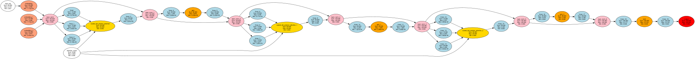
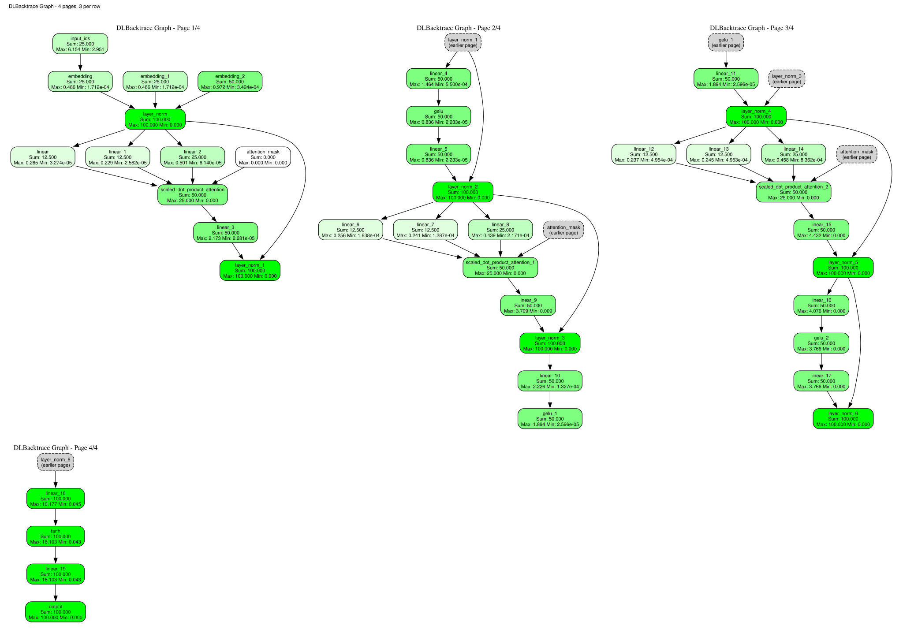

# DLBacktrace Guide

`DLBacktrace` is the main class for analyzing PyTorch models with DLBacktrace.

---

## Basic Usage

### Initialization

```python
from dl_backtrace.pytorch_backtrace import DLBacktrace

dlb = DLBacktrace(
    model=model,
    input_for_graph=(dummy_input,),
    device="cuda"
)
```

### Parameters

| Parameter | Type | Description | Default |
|-----------|------|-------------|---------|
| `model` | `nn.Module` | PyTorch model to trace | Required |
| `input_for_graph` | `tuple` | Example inputs for tracing | Required |
| `device` | `str` | Device type | `"cpu"` |

---

## Methods

### `predict()`

Runs forward pass and captures layer outputs.

```python
node_io = dlb.predict(*inputs)
```

**Parameters:**
- `*inputs`: Model inputs (tensors)

**Returns:**
- `dict`: Mapping of node names to (inputs, output) tuples

**Example:**
```python
test_input = torch.randn(1, 3, 224, 224)
node_io = dlb.predict(test_input)

for node_name, (inputs, output) in node_io.items():
    print(f"{node_name}: {output.shape}")
```

---

### `evaluation()`

Calculates relevance propagation.

```python
relevance = dlb.evaluation(
    mode="default",
    multiplier=100.0,
    task="multi-class classification"
)
```

**Parameters:**

| Parameter | Type | Description | Default |
|-----------|------|-------------|---------|
| `mode` | `str` | Evaluation mode | `"default"` |
| `multiplier` | `float` | Starting relevance value | `100.0` |
| `task` | `str` | Task type | Required |
| `thresholding` | `float` | Threshold for segmentation | `0.5` |

**Task Types:**
- `"binary-classification"`
- `"multi-class classification"`

**Returns:**
- `dict`: Mapping of node names to relevance scores

**Example:**
```python
relevance = dlb.evaluation(
    mode="default",
    multiplier=100.0,
    task="multi-class classification"
)

# Find most relevant layers
sorted_rel = sorted(
    relevance.items(),
    key=lambda x: abs(x[1]) if isinstance(x[1], (int, float)) else 0,
    reverse=True
)

print("Top 5 relevant layers:")
for name, score in sorted_rel[:5]:
    print(f"  {name}: {score}")
```

---

### `visualize()`

Generates visualization of the computational graph.

```python
dlb.visualize(
    save_path="my_graph.png"
)


---

### `visualize_dlbacktrace()`

Draws the relevance graph with Graphviz (the `graphviz` Python package and the `dot` program
must be installed) and saves it as SVG. By default it draws the most relevant nodes and their
paths to the output (`graph_mode="top_k"`).

```python
dlb.visualize_dlbacktrace(top_k=15, output_path="relevance_graph")

# the whole graph
dlb.visualize_dlbacktrace(graph_mode="entire", output_path="whole_graph")

# only the layers that matter (linear, conv, activation, normalization, attention,
# embedding, inputs, output), linked through the nodes that were left out
dlb.visualize_dlbacktrace(compact=True, graph_mode="entire", rankdir="TB", show_parameters=False)

# the same, with any layer types you choose
dlb.visualize_dlbacktrace(layer_types=["MLP_Layer", "Attention"], graph_mode="entire")

# a long graph as pages of 30 nodes, three pages per row in a grid
dlb.visualize_dlbacktrace(paginated=True, compact=True, pages_per_row=3, show_parameters=False,
                          output_path="pages")
```

| Parameter | Meaning |
|-----------|---------|
| `graph_mode` | `"top_k"` (default) or `"entire"`. `top_k` / `graph_top_k` and `graph_max_nodes` size the subgraph. |
| `layer_types` | Draw only nodes of these types: `"MLP_Layer"`, `"DL_Layer"`, `"Activation"`, `"Normalization"`, `"Attention"`, `"NLP_Embedding"`, `"Mathematical_Operation"`, `"Vector_Operation"`, `"Placeholder"` (the model inputs), `"Output"`, ... Applies in both graph modes and to pages. The output always stays. |
| `compact` | `True` is `layer_types=SEMANTIC_LAYER_TYPES` (importable from `dl_backtrace.pytorch_backtrace.dlbacktrace`). Ignored when `layer_types` is given. With the default `graph_mode="top_k"` the result is a top-k subgraph of those layers; use `graph_mode="entire"` for all of them. |
| `rankdir` | `"LR"` (default, wide), `"TB"` (tall, fits a page), `"RL"`, `"BT"`. Pages default to `"TB"`. |
| `paginated`, `max_nodes_per_page` | Split the graph into pages of at most `max_nodes_per_page` (default 30) nodes in execution order, saved as `{output_path}_page1.svg`, `..._page2.svg`, ... A parent on an earlier page is drawn as a dashed grey stub, so no edge is lost. |
| `pages_per_row` | With `paginated=True` and more than one page, also save one grid with this many pages per row, `{output_path}_combined.svg`. |
| `relevance_stat` | `"sum"` (default) or `"mean"`: what the first line of each node label shows. |
| `show_parameters` | `True` (default) draws the parameter, buffer and constant placeholders (`p_*`, `b_*`, `c_*`); `False` leaves them out in every mode. They carry no relevance. In a paginated or compact graph they fill whole pages and make the graph larger, so `show_parameters=False` is usually what you want there. |
| `show`, `inline_format` | Display the graph inline in a notebook, as `"svg"` or `"png"`. |

Nodes are coloured by layer type, and in pages by the sign and size of the relevance (green
positive, red negative, darker is larger).

**What the label shows.** Each node shows `Sum`, `Max` and `Min` of its relevance. The sum
is the node's total relevance; it does not depend on the size of the tensor, so it can be
compared between nodes: where a layer splits its relevance among inputs, the parts add up to
the whole (in the compact example below, `layer_norm` 100 goes to the attention block's three
projections as 12.5 + 12.5 + 25 and to the residual path). The mean divides by the tensor
size, so the same total reads differently on a `[1, 7, 64]` and a `[1, 7, 32]` tensor. Older
versions showed the mean; pass `relevance_stat="mean"` to get it back.

**Compact graphs and residual connections.** The compact graph links each kept layer to the
nearest kept layers before it. In a model with residual connections the additions are not
kept, so a layer is linked to every earlier layer whose output reaches it through the
residual stream, which makes the graph dense. Add `"Mathematical_Operation"` to
`layer_types` to keep the additions and see the residual stream.

The two examples below were made with `show_parameters=False`.





---

## Complete Example

```python
import torch
import torch.nn as nn
from dl_backtrace.pytorch_backtrace import DLBacktrace

# Define model
class CNN(nn.Module):
    def __init__(self):
        super().__init__()
        self.conv1 = nn.Conv2d(3, 32, 3, padding=1)
        self.relu = nn.ReLU()
        self.pool = nn.AdaptiveAvgPool2d(1)
        self.fc = nn.Linear(32, 10)
    
    def forward(self, x):
        x = self.pool(self.relu(self.conv1(x)))
        return self.fc(x.flatten(1))

# Initialize
model = CNN()
model.eval()

dummy_input = torch.randn(1, 3, 32, 32)
dlb = DLBacktrace(
    model=model,
    input_for_graph=(dummy_input,),
    device="cpu"
)

# Analyze
test_input = torch.randn(1, 3, 32, 32)
node_io = dlb.predict(test_input)

relevance = dlb.evaluation(
    mode="default",
    multiplier=100.0,
    task="multi-class classification"
)

# Visualize
dlb.visualize()
dlb.visualize_dlbacktrace(top_k=10)

print("Analysis complete!")
```

---

## Tips & Best Practices

!!! tip "Use Evaluation Mode"
    Always set model to eval mode: `model.eval()`

!!! tip "Match Input Shapes"
    Ensure dummy input shape matches real input shape

!!! tip "GPU Memory"
    Monitor memory usage for large models

!!! warning "Unsupported Operations"
    Some custom ops may not be supported. Check error messages.

---

## Next Steps

- [Execution Engines](execution-engines.md) - Learn about execution options
- [Supported Operations](operations.md) - See all supported operations
- [Examples](../../examples/colab-notebooks.md) - Interactive notebooks
- [Best Practices](../best-practices.md) - Tips for effective use


